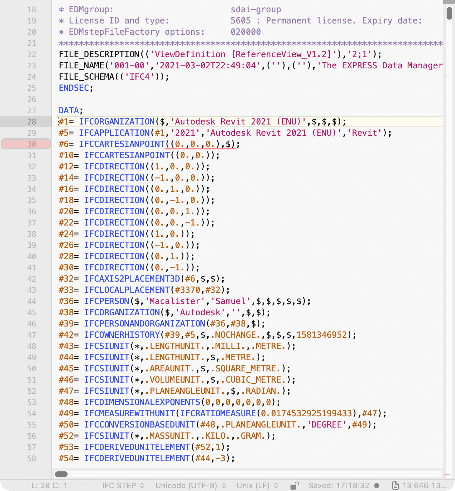

# BBEdit



[`IFC.plist`](IFC.plist) is a codeless language module, with patterns taken from the
[Sublime Text syntax](../sublime/IFC.sublime-syntax), that also starts the language server through BBEdit's built-in
LSP support. From the root of this repository, copy it into place and restart BBEdit:

```sh
mkdir -p ~/Library/Application\ Support/BBEdit/Language\ Modules
cp bbedit/IFC.plist ~/Library/Application\ Support/BBEdit/Language\ Modules/
```

BBEdit finds `ifc-language-server` on your login shell's `PATH`. The language server needs a licence or the trial:
BBEdit's free mode keeps the colouring but has no LSP support.

Tested with BBEdit 16.1 in its trial: on a 13.6 MB and a 56 MB file, colouring and diagnostics work (an unknown entity
and a wrong attribute count are underlined and counted in the navigation bar). Hover, go-to-definition, references, completion and signature
help are untested. BBEdit doesn't request semantic tokens or document symbols, so colouring comes from the module alone
and there is no outline. At quit BBEdit logs that the server didn't shut down in time.
