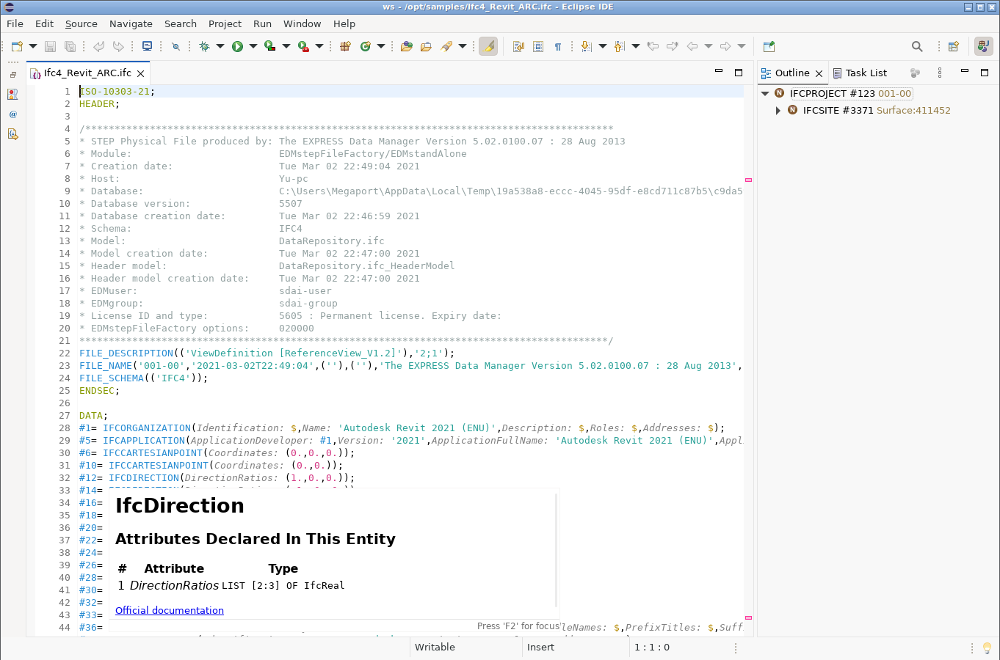

# Eclipse IDE



You need [LSP4E](https://github.com/eclipse-lsp4e/lsp4e) and [TM4E](https://github.com/eclipse-tm4e/tm4e), both
bundled with the Eclipse IDE for Java Developers. The grammar is from
[vscode-ifc](https://github.com/NepomukWolf/vscode-ifc), Copyright (c) 2026 Nepomuk Wolf, MIT licence
([`LICENSE-vscode-ifc`](LICENSE-vscode-ifc)). With Eclipse closed, copy the grammar and the launch configuration into
place from the root of this repository (the second path is your workspace, `~/eclipse-workspace` by default):

```sh
mkdir -p ~/.eclipse/ifc ~/eclipse-workspace/.metadata/.plugins/org.eclipse.debug.core/.launches
cp eclipse/ifc.tmLanguage.json ~/.eclipse/ifc/
cp "eclipse/IFC Language Server.launch" ~/eclipse-workspace/.metadata/.plugins/org.eclipse.debug.core/.launches/
```

Then start Eclipse and, in **Window > Preferences** (**Eclipse > Settings…** on macOS):

1. **General > Content Types**: select **Text**, click **Add Child…**, name it `IFC STEP`, then add `*.ifc` under
   **File associations**.
2. **TextMate > Grammar**: click **Add…**, enter the full path of `~/.eclipse/ifc/ifc.tmLanguage.json` (for example
   `/home/you/.eclipse/ifc/ifc.tmLanguage.json`), and click **Finish**.
3. **Language Servers**: click **Add…**, choose **Text > IFC STEP** on the left and **Program > IFC Language Server** on
   the right, and click **OK**.

Open IFC files with **File > Open File…**. The launch configuration finds `ifc-language-server` on Eclipse's `PATH`;
if Eclipse doesn't inherit your shell's `PATH`, set the full path under **Run > External Tools > External Tools
Configurations… > IFC Language Server > Location**. It sends the server's protocol output to `/dev/null`, so
the Console doesn't fill with it. On Windows, change that to `NUL` on the **Common** tab. To see the server's errors, untick that option on the launch configuration's **Common** tab.

On small files, colouring, diagnostics, hover, go-to-definition (F3), references (Shift+Ctrl+G), document highlight,
inlay hints, outline and the `!` scaffold completion work. Files up to about 9 MB settle within 30 seconds.

Files with very long lines freeze Eclipse. A 13.6 MB file with a 1 MB line shows colouring, outline and hover, then
freezes. A 56 MB file gets colouring, but its outline never arrives. Semantic colouring isn't available in Eclipse.

Not checked yet: macOS, Windows, signature help.
