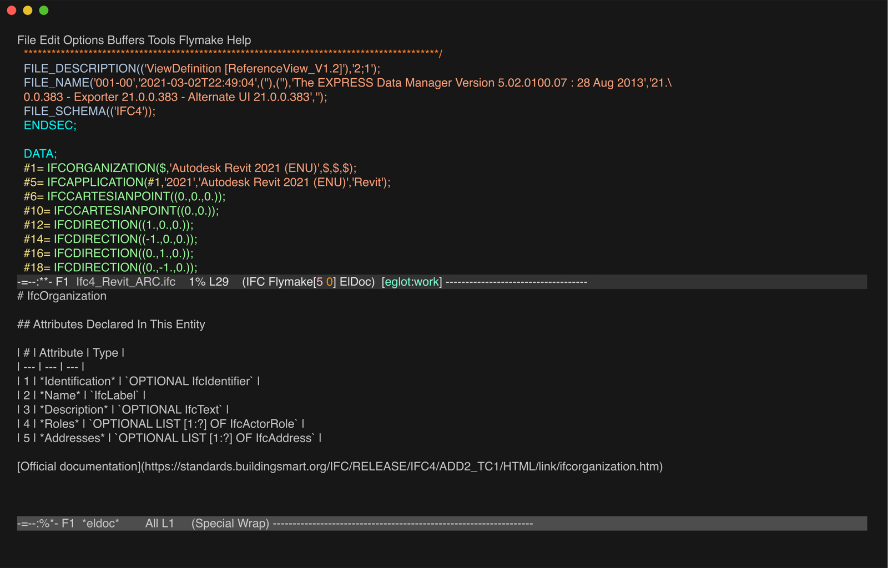

# Emacs



You need Emacs 29 or later. Put [`ifc-mode.el`](ifc-mode.el) in a directory on your `load-path` and add this to
`init.el`:

```elisp
(require 'ifc-mode)
(with-eval-after-load 'eglot
  (add-to-list 'eglot-server-programs
               '(ifc-mode . ("ifc-language-server"
                             :initializationOptions (:semanticTokensEnabled :json-false)))))
(add-hook 'ifc-mode-hook #'eglot-ensure)
```

Colouring, diagnostics, hover, go-to-definition, references and completion work on files of at least 56 MB.

Semantic colouring isn't available in Emacs, so the snippet turns it off.

The outline (`imenu`) takes seconds on a 13.6 MB file and minutes on a 56 MB one.

Emacs asks before opening files above `large-file-warning-threshold` (10 MB by default).
