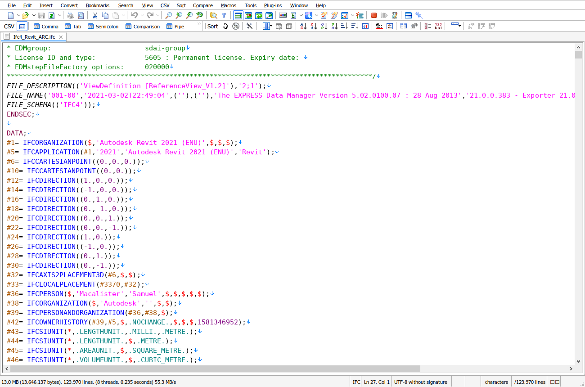

# EmEditor

This is colouring only: EmEditor's language server setting offers a fixed list of servers and no custom command.

1. Open **Tools > Select Configuration > Define Configurations…**, click **New**, keep **Use default configuration**,
   click **OK** and name the new configuration `IFC`.
2. With `IFC` selected, click **Properties**, open the **Highlight (1)** page, click **Import…**, choose
   [`ifc.esy`](ifc.esy) and click **OK**.
3. Back in **Define Configurations**, click **Associations…**, click **New**, type `*.ifc`, choose `IFC` under
   **Configuration** and click **OK**.

**Import…** adds to the strings already on **Highlight (1)**, so delete the old ones before importing a newer
`ifc.esy`.

Section keywords, header entities, entity names, `#id` references, strings with `''` escapes, enums and booleans,
numbers, `$` and `*`, and `/* */` comments are coloured. Files up to at least 2.75 GB stay coloured, and lines of 1 MB
stay responsive.
