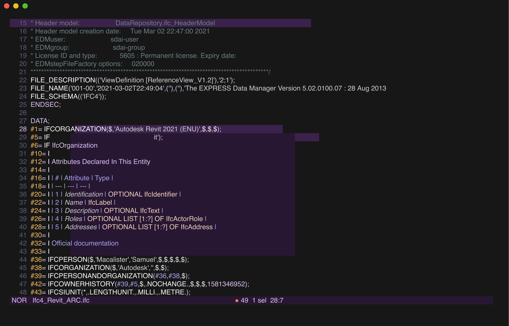

# Helix



Add [`languages.toml`](languages.toml) to `~/.config/helix/languages.toml`. It uses the
[tree-sitter-ifc](https://github.com/NepomukWolf/tree-sitter-ifc) grammar, pinned by commit.

Then build the grammar and install its highlight query:

```sh
hx --grammar fetch && hx --grammar build
mkdir -p ~/.config/helix/runtime/queries/ifc
cp ~/.config/helix/runtime/grammars/sources/ifc/queries/highlights.scm ~/.config/helix/runtime/queries/ifc/
```

The server connection works at any file size. Helix stops parsing after a fixed 500 ms. Files above roughly 8 MB
stay uncoloured.
