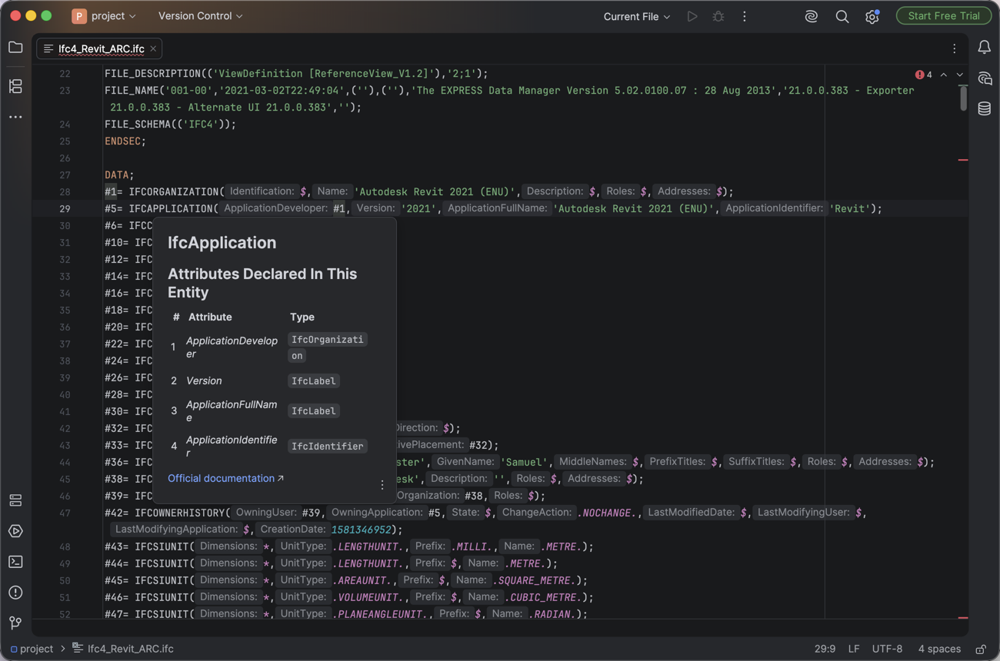

# JetBrains IDEs

IntelliJ IDEA 2026.2 or later (its free tier is enough) with Red Hat's
[LSP4IJ](https://github.com/redhat-developer/lsp4ij) plugin; tested with IntelliJ IDEA 2026.2.4 and LSP4IJ 0.21.0.
Colouring comes from a TextMate bundle built from [vscode-ifc](https://github.com/NepomukWolf/vscode-ifc)'s grammar
and language configuration.



With the IDE closed, install LSP4IJ (or install it from **Settings > Plugins**):

```sh
idea installPlugins com.redhat.devtools.lsp4ij
```

Then, in the IDE:

1. **Settings > Editor > TextMate Bundles**, **+**, and choose the [`jetbrains/ifc-textmate`](ifc-textmate) folder of
   this repository. The IDE reads the bundle from there, so keep the folder.
2. **Settings > Languages & Frameworks > Language Servers**, **+**, set **Template** to **Import from custom
   template...**, choose [`jetbrains/lsp4ij-template`](lsp4ij-template), and press **OK**.
3. **Help > Edit Custom Properties**, add the lines below, and restart. Without them, files above 2.5 MB open as plain
   text without colouring, and files above 20 MB don't open in the text editor.

   ```properties
   idea.max.intellisense.filesize=200000
   idea.max.content.load.filesize=200000
   ```

4. For files of about 50 MB, raise **Help > Change Memory Settings** to 4096 MB; with the default 2048 MB the IDE runs
   out of memory on them.

Find references with **LSP Reference(s)** (**Go To** in the editor's context menu, or
<kbd>Ctrl</kbd>+<kbd>Alt</kbd>+<kbd>H</kbd>); the IDE's own **Show Usages** finds nothing. LSP4IJ only requests
full-document semantic tokens, which the server does not provide, so the template turns them off. The IDE's spell
checker marks entity names as typos; turn off **Settings > Editor > Inspections > Proofreading > Typo** if that gets in
the way.

Tested on macOS with 25 KB, 13.6 MB and 56 MB files: colouring, diagnostics, hover, go-to-definition, references,
outline (**Structure**), inlay hints with attribute names, and completion, which the server only offers for the `!ifc`
boilerplate. On the 56 MB file, the editor freezes for 10 to 20 seconds when opening it and after edits, and
diagnostics take up to a minute to update. The two **Settings** steps were run through the IDE APIs behind those pages
rather than clicked through. Semantic tokens and other JetBrains IDEs (PyCharm, WebStorm, Rider, and so on) are
untested; LSP4IJ and TextMate bundles exist for them too, so the same setup should apply.
