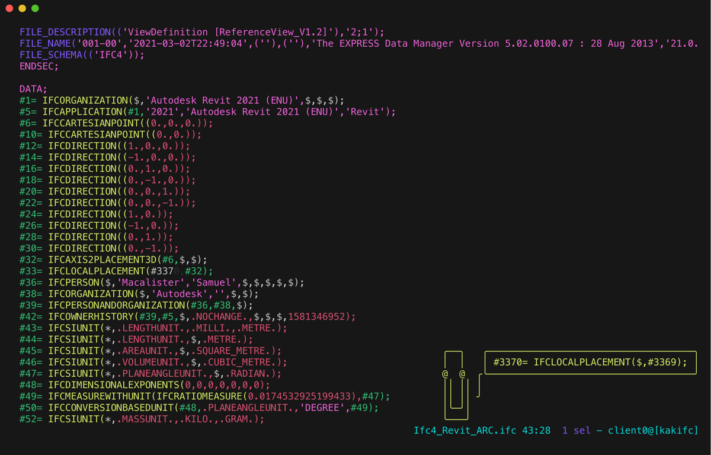

# Kakoune

Colouring comes from Kakoune highlighters in [`ifc.kak`](ifc.kak); [`ifc-lsp.kak`](ifc-lsp.kak) connects the server
through [kakoune-lsp](https://github.com/kakoune-lsp/kakoune-lsp).



Install Kakoune from your distribution's package and kakoune-lsp from its
[releases](https://github.com/kakoune-lsp/kakoune-lsp/releases) or with `cargo install --locked kak-lsp`. On macOS,
with Homebrew:

```sh
brew install kakoune kakoune-lsp/kakoune-lsp/kakoune-lsp
```

From the root of this repository, copy the files into your config:

```sh
mkdir -p ~/.config/kak
cp kakoune/ifc.kak kakoune/ifc-lsp.kak ~/.config/kak/
```

Then add to `~/.config/kak/kakrc`:

```kak
eval %sh{kak-lsp}
source "%val{config}/ifc.kak"
source "%val{config}/ifc-lsp.kak"
lsp-enable
```

`.ifc` files are detected by name; `.stp`, `.step` and `.p21` files only when their first line is `ISO-10303-21;`. The
highlighter patterns follow the [Neovim syntax file](../neovim/syntax/ifc.vim). Leave `lsp_debug` off on large files:
kak-lsp then copies the whole document into the `*debug*` buffer, and an edit freezes Kakoune.

Tested with Kakoune 2026.05.21 and kakoune-lsp 22.0.0: on a 13.6 MB file, colouring, diagnostics, hover,
go-to-definition (`lsp-definition`), references, outline (`lsp-document-symbol`) and completion of the `!ifc`
boilerplate work; a 56 MB file opens at once with the same features, and diagnostics arrive about 30 seconds after an
edit. There are no semantic tokens: kak-lsp requests them for the whole document only, and the server offers them per
range.
