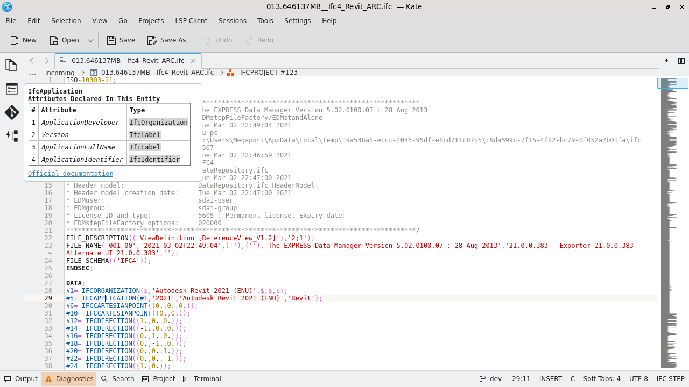

# Kate



From the root of this repository, copy the syntax definition and the LSP configuration into place. If you already have
`settings.json`, merge [`lspclient-settings.json`](lspclient-settings.json) in via **Settings > Configure Kate > LSP
Client > User Server Settings** instead.

```sh
mkdir -p ~/.local/share/org.kde.syntax-highlighting/syntax ~/.config/kate/lspclient
cp kate/ifc.xml ~/.local/share/org.kde.syntax-highlighting/syntax/ifc.xml
cp kate/lspclient-settings.json ~/.config/kate/lspclient/settings.json
```

Enable semantic highlighting in the LSP Client settings. Raise **Settings > Configure Kate > Editing > Line Length
Limit**, as very long STEP lines otherwise make the document read-only. Kate asks once to trust the server command.

Tested with Kate 26.11: on a 13.6 MB file, diagnostics, hover, go-to-definition, references, completion and outline
work, and Kate requests semantic tokens for the visible range; a 56 MB file gets diagnostics, outline and semantic
tokens.
