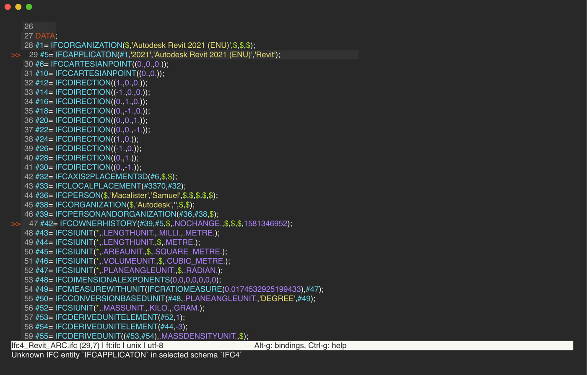

# micro



From the root of this repository, copy the syntax file and install the
[lsp](https://github.com/AndCake/micro-plugin-lsp) plugin.

```sh
mkdir -p ~/.config/micro/syntax
cp micro/ifc.yaml ~/.config/micro/syntax/ifc.yaml
micro -plugin install lsp
```

If you already have a `~/.config/micro/settings.json`, merge the two keys from [`settings.json`](settings.json) into it.
If you have none, copy the file:

```sh
cp micro/settings.json ~/.config/micro/settings.json
```

The syntax file picks `.ifc` files by extension and other files by an `ISO-10303-21;` first line. `lsp.formatOnSave`
is off because the server offers no formatting.

In an IFC file:

- Alt-K shows hover in the status bar.
- Alt-D goes to the definition.
- Alt-R lists references in a split. Enter on a line opens it in a new tab. Ctrl-Q closes the split.
- Ctrl-Space completes.

Diagnostics mark the gutter. Their message shows when the cursor is on them.

On small files, colouring, diagnostics, hover, go-to-definition, references and the `!ifc` boilerplate completion
work. Hover arrives as one status-bar line, with the markdown unrendered and cut at the screen width. The plugin has
no outline, semantic tokens, signature help or inlay hints.

Large files freeze micro on open and after every edit. A 13.6 MB file takes four to six and a half minutes to reach
the server. After that, hover, go-to-definition and references answer at once. But an edit then takes more than
seven minutes to reach the server. A 56 MB file doesn't reach the server within 11 minutes. Without the plugin,
colouring handles a 56 MB file and fills in within about 30 seconds.
