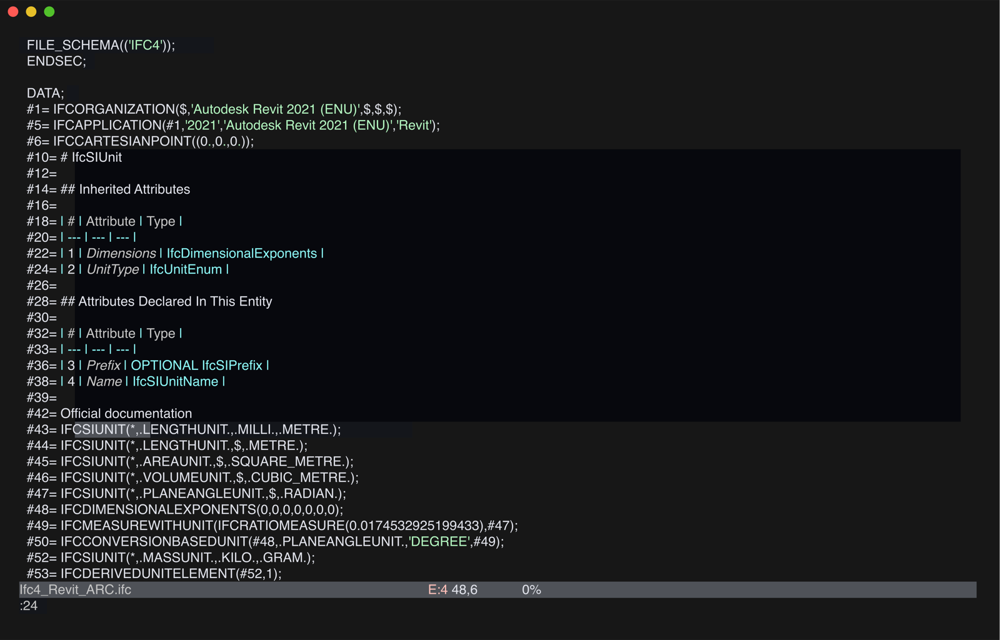

# Neovim



You need Neovim 0.11 or later. From the root of this repository, copy the syntax, file-type and LSP files into your
config:

```sh
cp -R neovim/ftdetect neovim/lsp neovim/syntax ~/.config/nvim/
```

If your config lives elsewhere, for example on Windows, copy them to the directory `:echo stdpath('config')` prints.

Then enable the server in `init.lua`:

```lua
vim.lsp.enable('ifc')
```

Colouring and the server connection work on files of at least 180 MB. Size-based detection such as LazyVim's
snacks.nvim `bigfile` leaves `.ifc` files alone. On lines of hundreds of thousands of characters, semantic colours take
minutes to fill in.
