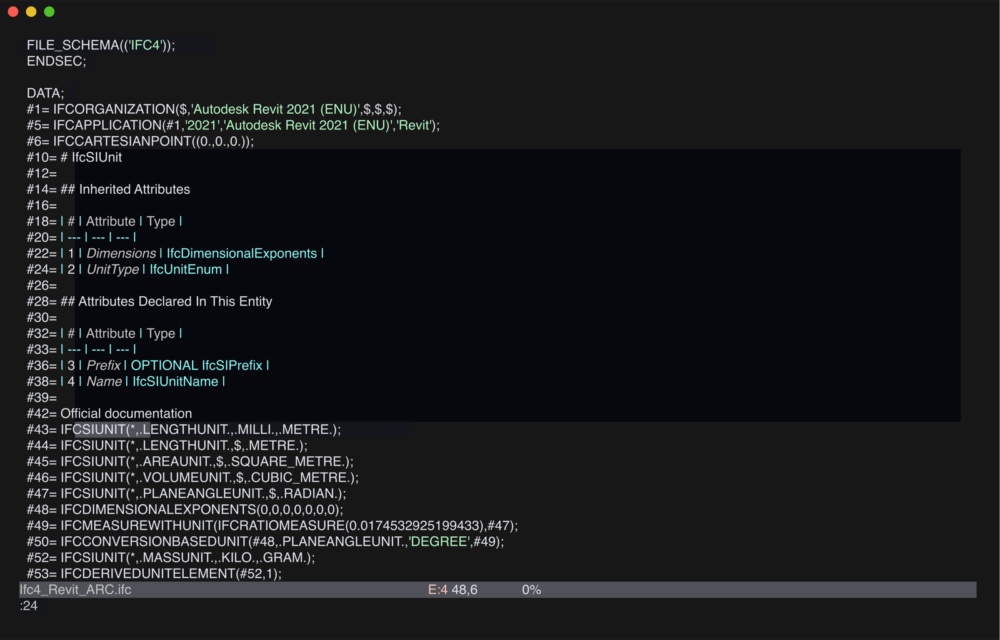

# Neovim



You need Neovim 0.11 or later. From the root of this repository, copy the syntax, file-type and LSP files into your
config:

```sh
cp -R neovim/ftdetect neovim/lsp neovim/syntax ~/.config/nvim/
```

If your config lives elsewhere, for example on Windows, copy them to the directory `:echo stdpath('config')` prints.

Then enable the server in `init.lua`:

```lua
vim.lsp.enable('ifc')
```

Colouring and the server connection work on files of at least 180 MB. Size-based detection such as LazyVim's
snacks.nvim `bigfile` leaves `.ifc` files alone. On lines of hundreds of thousands of characters, semantic colours take
minutes to fill in.

Inlay hints, the attribute name before each argument, stay off until you turn them on, for example with
`:lua vim.lsp.inlay_hint.enable()`. Neovim asks for the hints of the whole file after every edit
([neovim/neovim#42848](https://github.com/neovim/neovim/issues/42848)), which on large files means every hint in the
file ([IFC-Language-Server#158](https://github.com/NepomukWolf/IFC-Language-Server/issues/158)). `lsp/ifc.lua`
therefore asks only for the visible lines and one window height above and below, and asks again once scrolling stops
and the window has left those lines. It replaces the client's `request` method and calls
`vim.lsp.inlay_hint.on_refresh`, which Neovim marks as private, so a later Neovim release may need it changed. Once
Neovim asks for the visible lines itself, the workaround can go.
