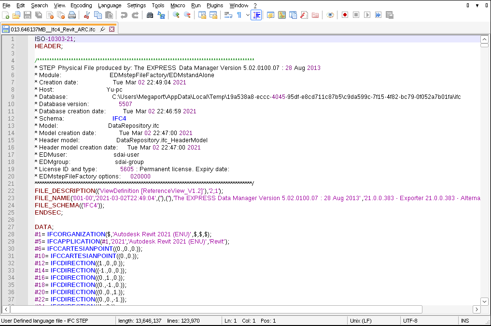

# Notepad++

Open **Language > User Defined Language > Define your language…**, click **Import…**, choose
[`IFC_STEP.udl.xml`](IFC_STEP.udl.xml) and restart. `.ifc` files are coloured up to at least 56 MB.

This gives colouring only. The NppLspClient plugin doesn't load in Notepad++ 8.9.
