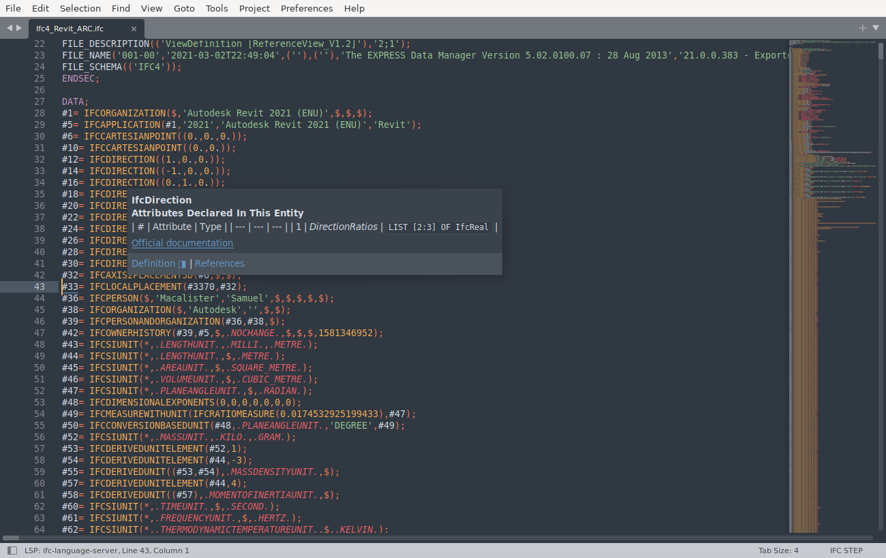

# Sublime Text



Install the [LSP](https://packagecontrol.io/packages/LSP) package through Package Control and copy
[`IFC.sublime-syntax`](IFC.sublime-syntax) into `Packages/User/` (**Preferences > Browse Packages…**):

```sh
cp sublime/IFC.sublime-syntax "<Packages>/User/"
```

Then open **Preferences > Package Settings > LSP > Settings**. From [`LSP.sublime-settings`](LSP.sublime-settings),
merge the `clients.ifc-language-server` entry and `"semantic_highlighting": true` into your settings. Restart Sublime.

Colouring, diagnostics, completion, hover and go-to-definition work. Hover's attribute table shows as raw Markdown.
Not checked yet: references, outline.

A 56 MB file opens as Plain Text. Choose **View > Syntax > IFC STEP** for it.
