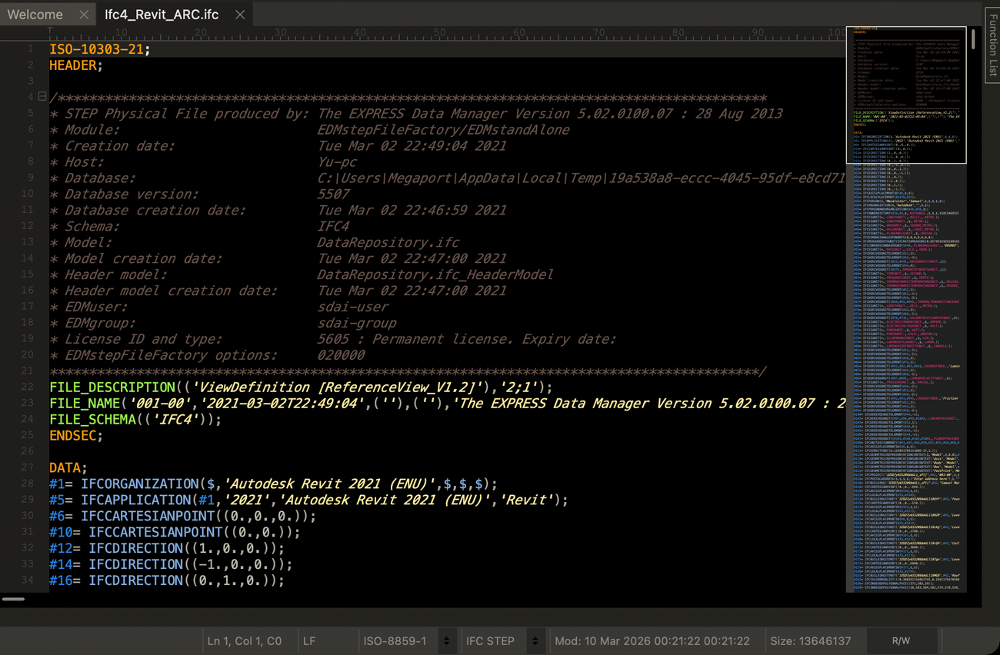

# UltraEdit



[`ifc.uew`](ifc.uew) is a wordfile that colours `.ifc` files. This is colouring only: UltraEdit has no LSP client.

1. Open **Settings > Editor Display > Syntax Highlighting** and note **Full path to folder containing wordfiles**.
   By default it is `%APPDATA%\IDMComp\UltraEdit\wordfiles` on Windows,
   `~/Library/Application Support/UltraEdit/wordfiles` on macOS and `~/.idm/uex/wordfiles` on Linux.
2. Copy `ifc.uew` into that folder and restart UltraEdit. The status bar shows **IFC STEP** for `.ifc` files.

On macOS, from the root of this repository:

```sh
cp ultraedit/ifc.uew ~/Library/Application\ Support/UltraEdit/wordfiles/
```

Section keywords, header entities, entity names starting with `IFC`, `#id` references, strings, enumerations and
booleans, `$`, `*` and comments each get a colour group, and numbers use the theme's number colour. The theme picks the
colours.

Colouring stays on for files of at least 1 GB. If **Settings > File Handling > Large Files** is set to disable syntax
highlighting, files above its threshold open without colouring. Lines longer than 4096 columns can be miscoloured where
UltraEdit wraps them.
