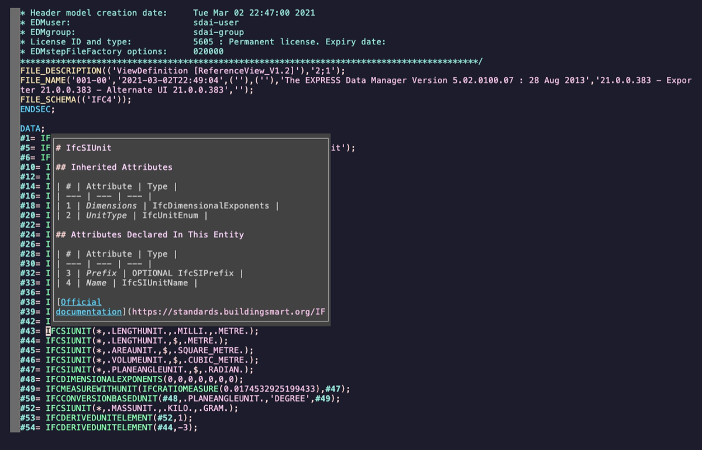

# Vim



You need Vim 9 with [vim-lsp](https://github.com/prabirshrestha/vim-lsp). The syntax file is the one in
[`neovim/syntax/`](../neovim/syntax/ifc.vim). From the root of this repository, copy the syntax, file-type and server
files into `~/.vim`. Then install vim-lsp as a package:

```sh
mkdir -p ~/.vim/syntax ~/.vim/pack/plugins/start
cp neovim/syntax/ifc.vim ~/.vim/syntax/
cp -R vim/ftdetect vim/plugin ~/.vim/
git clone https://github.com/prabirshrestha/vim-lsp ~/.vim/pack/plugins/start/vim-lsp
```

Your `vimrc` needs `filetype on` and `syntax on`.
[`plugin/ifc-lsp.vim`](plugin/ifc-lsp.vim) registers the server. It also sets omni completion (`CTRL-X CTRL-O`) for
IFC buffers. Use `:LspHover`, `:LspDefinition`, `:LspReferences` and `:LspDocumentSymbol`.

To use [yegappan/lsp](https://github.com/yegappan/lsp) instead, run these in place of the block above:

```sh
mkdir -p ~/.vim/syntax ~/.vim/pack/plugins/start
cp neovim/syntax/ifc.vim ~/.vim/syntax/
cp -R vim/ftdetect ~/.vim/
git clone https://github.com/yegappan/lsp ~/.vim/pack/plugins/start/lsp
```

Then add this line to your `vimrc`. It too needs `filetype on` and `syntax on`.

```vim
autocmd User LspSetup call LspAddServer([#{name: 'ifc-language-server', filetype: ['ifc'], path: 'ifc-language-server', args: []}])
```

With vim-lsp, colouring, diagnostics, hover, go-to-definition, references and outline work on files of at least
56 MB. Diagnostics refresh about 12 s after an edit to a 56 MB file. Completion offers the `!ifc` boilerplate.

There is no semantic colouring with either client. With yegappan/lsp, diagnostics, hover, go-to-definition and
references work. Not checked yet: yegappan/lsp on large files.
